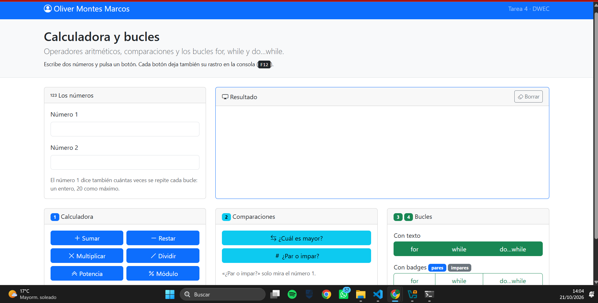
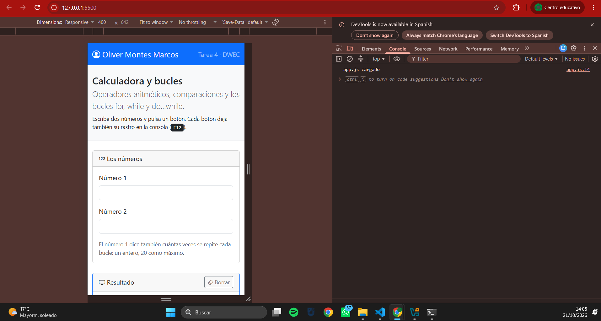
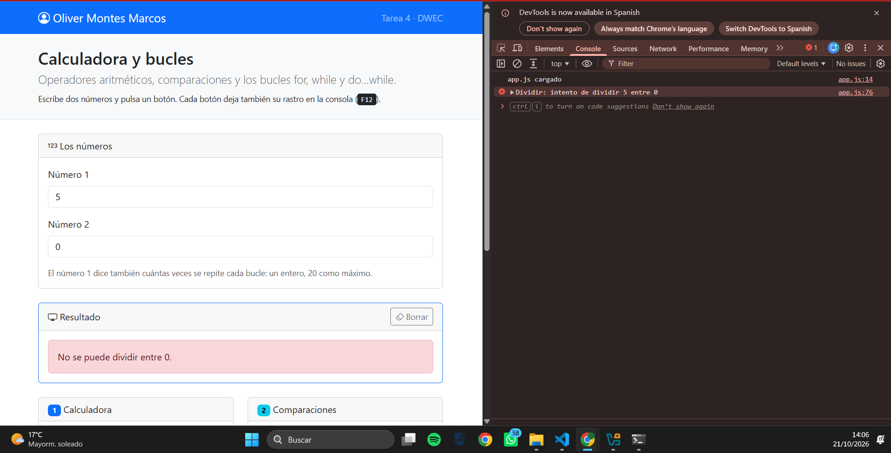
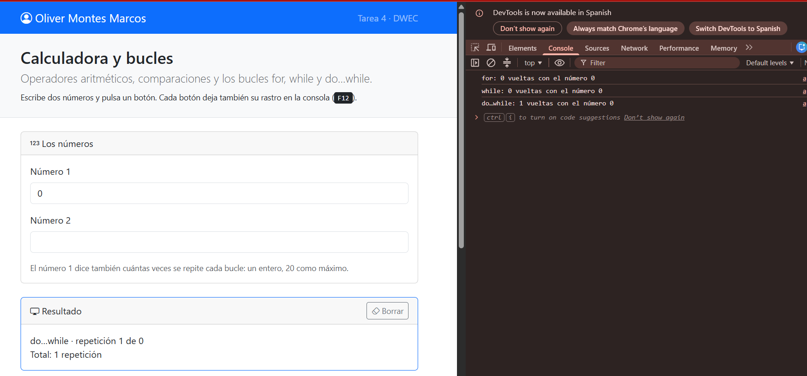
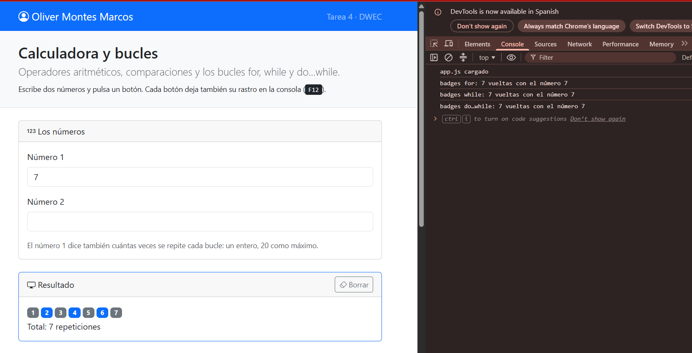

# Tarea 4 · Calculadora y bucles

**Autor:** Oliver Montes Marcos · Desarrollo Web en Entorno Cliente (DWEC) · 2.º DAW · Curso 2026-27

> **Plantilla de la tarea 4.** Cómo usarla:
>
> 1. Copia esta carpeta en tu repositorio de DWEC y cámbiale el nombre a `tema04`.
> 2. `index.html` trae lo imprescindible para empezar: las dos casillas, la zona de resultado y el botón «Sumar». El resto de la página y su maquetación con Bootstrap los haces tú.
> 3. `js/app.js` trae `sumar()` hecha como modelo y las demás funciones con `TODO`.
> 4. `js/ayudas.js` no se toca: son las funciones que leen las casillas y escriben el resultado.
> 5. Sustituye las imágenes de `capturas/` por las tuyas, **con el mismo nombre**.
> 6. Todo lo que va entre [corchetes] es un hueco: cámbialo por lo tuyo. Al terminar, borra este aviso.

Pagina con una calculadora, dos comparaciones y seis bucles, hecha en Bootstrap. Para probarla: Abrir carpeta en VS Code, pulsar Go Live, escribir dos numeros o uno depende de la accion y pulsar los botones con la consola abierta F12

## Capturas

### a) La página entera

Se ve mi nombre en navbar y pie de pagina. Arriba estan las cards de los numeros y resultado, debajo una card por ejercicio, repartidas en columnas con la rejilla Bootstrap.

### b) La página en el móvil

En el modo movil de F12 (400px de ancho) las cards pasan a una sola columna, una debajo de otra y los botones ocupan todo el ancho.

### c) El error de dividir entre 0

Con 5 y 0, el boton dividir muestra en la pagina un aviso rojo y en consola un error con la operacion que se intento. Sin el IF, javascript habria devuelto Infinity

### d) Los tres bucles con el número 0

Con el numero 1 en 0, for y while dan 0 vueltas y do...while da 1. En la consola se ven 3 lineas y en la pagina queda el resultado del ultimo bucle pulsado en este caso do...while

### e) Un bucle con badges

Con el numero 7 salen siete badges. El color se elige con el ternario i % 2 === 0 ? "primary" : "secondary", los pares en azul y impares en gris. Debajo aparece el total.

## Reflexión

Los 3 bucles repiten un bloque, pero se diferencian en cuando comprueban la condicion. 
For junta inicio, condicion y avance en una linea, y es el que uso cuando se cuantas veces repetir.
While comprueba condicion antes de cada vuelta y usaria cuando la repeticion depende de algo que va cambiando
Do...while ejecuta el bloque primero y despues comprueba, asi que al menos 1 vuelta da.
Lo vi con el 0, el bucle for y while no entraron ninguna vez, porque 1 <= 0 ya es falso al empezar pero do...while entro una, porque la comprobacion llega al final. Por eso solo lo usaria cuando el bloque tenga que ejecutarse una vez minimo, por ejemplo para pedir un dato

## Fuentes

- [Bootstrap 5.3: sistema de rejilla](https://getbootstrap.com/docs/5.3/layout/grid/)
- [MDN: do...while](https://developer.mozilla.org/es/docs/Web/JavaScript/Reference/Statements/do...while)

## Uso de IA

He usado Claude, para orientarme con codigos y para solucionar algun fallo de GitHub. 
