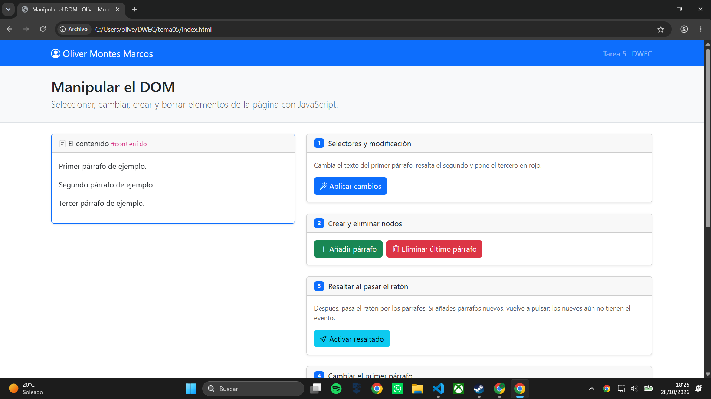
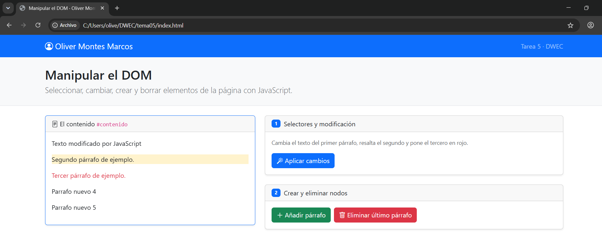
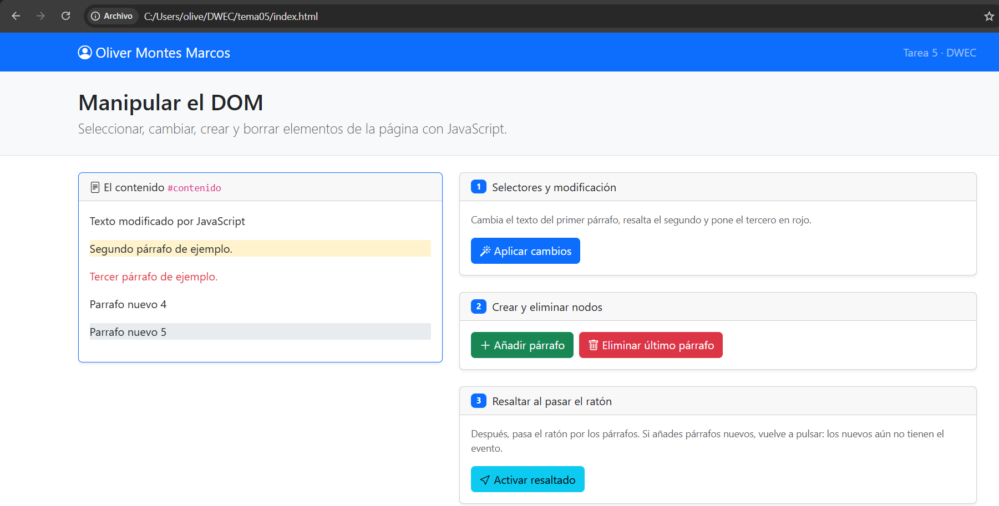
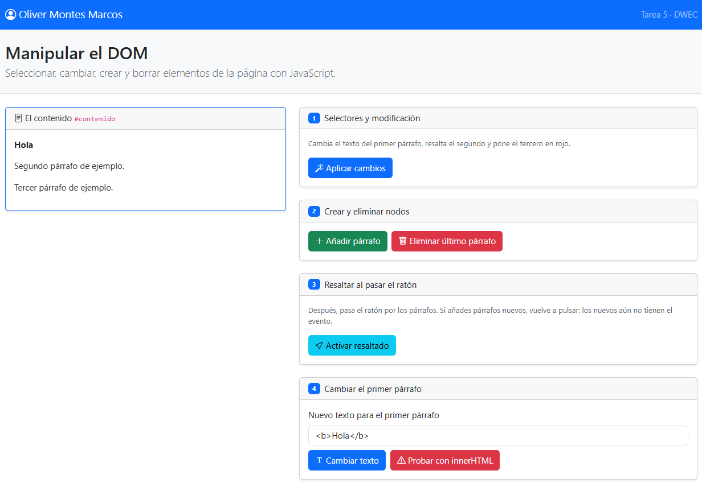
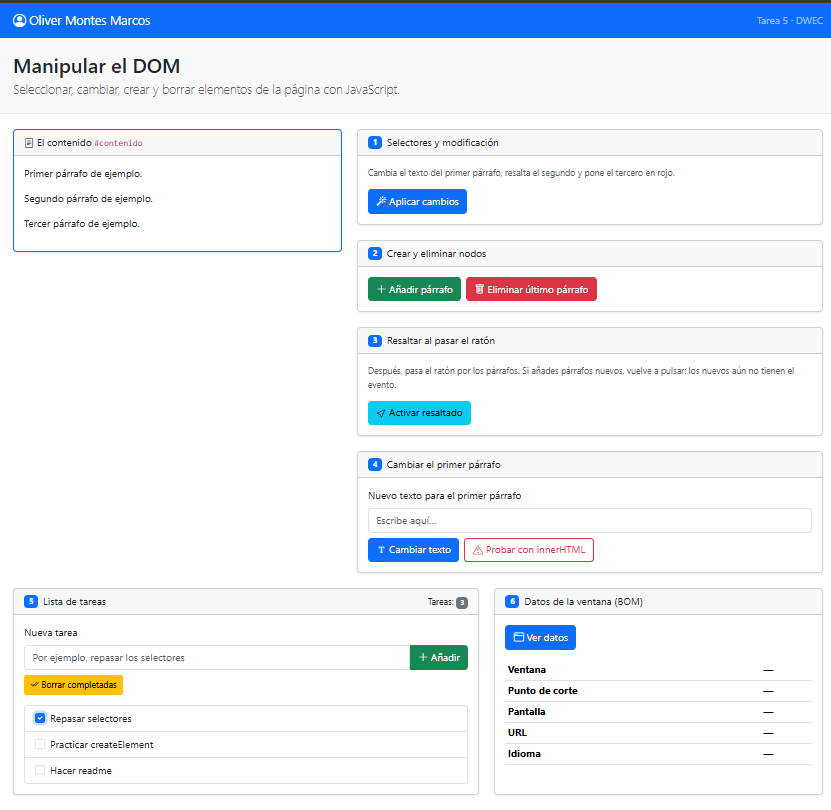
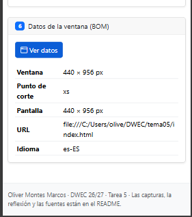
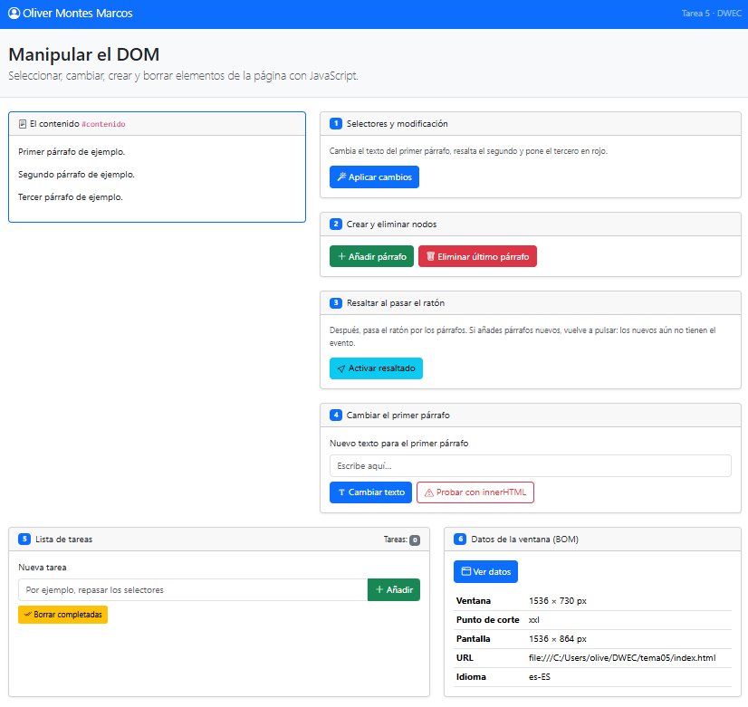

# Tarea 5 · Manipular el DOM

**Autor:** Oliver Montes Marcos · Desarrollo Web en Entorno Cliente (DWEC) · 2.º DAW · Curso 2026-27

> **Plantilla de la tarea 5.** Cómo usarla:
>
> 1. Copia esta carpeta en tu repositorio de DWEC y cámbiale el nombre a tema05.
> 2. index.html ya está maquetado: es la página que vas a manipular. No cambies los id ni las clases que usa el JavaScript.
> 3. js/app.js trae una función por botón con TODO, y modelos en los ejercicios 1, 3 y 6.
> 4. Sustituye las imágenes de capturas/ por las tuyas, **con el mismo nombre**.
> 5. Todo lo que va entre [corchetes] es un hueco: cámbialo por lo tuyo. Al terminar, borra este aviso.

Esta carpeta contiene una pagina con seis ejercicios de manipulacion del DOM y del BOM con JavaScript. Para probarla, abre la carpeta en VS Code, pulsa **Go Live** y usa los botones con la consola abierta (F12).

## Capturas

### a) La página recién cargada

Se ve mi nombre en el navbar y los tres parrafos de partida, sin modificar

### b) Ejercicios 1 y 2

El primer parrafo cambia de texto (getElementById), el segundo se resalta en amarillo (querySelector(".segundo")) y el tercero sale en rojo (querySelectorAll("#contenido p")[2]), debajo aparecen los dos parrafos creados con createElement y append

### c) Ejercicio 3: resaltado al pasar el ratón

Esta resaltado el parrafo bajo el raton. Los parrafos que se añaden despues de pulsar <Activar resaltado> no se resaltan hasta volver a pulsarlo, porque el evento solo se asigna a los parrafos que existen en ese momento.

### d) Ejercicio 4: `<b>hola</b>` con innerHTML

Con <Cambiar texto> (textContent) el parrafo muestra la etiqueta literal, <b>Sin inner</b>. Con <Probar con innerHTML> el navegador la interpreta y muestra **Con inner** en negrita. 

### e) Ejercicio 5: la lista de tareas

Tres tareas, una marcada, antes de pulsar <Borrar completada>, el contador marca 3.

### f) Ejercicio 6: los datos de la ventana en el móvil

En el móvil (440 px de ancho) sale el punto de corte xs; en mi ordenador sale xxl. (He puesto en el movil la captura del footer con mi nombre porque no me deja poner el del navbar.)

## Reflexión

textContent inserta lo que se le da como texto plano, mientras que innerHTML lo interpreta como HTML. Con <b>hola</b>, el primero muestra las etiquetas tal cual y el segundo escribe «hola» en negrita. Por eso no se debe usar innerHTML con lo que escribe el usuario: podría meter etiquetas o scripts que se ejecuten en la página (ataque XSS). Para mostrar texto de un usuario es más seguro textContent, y por eso las tareas del ejercicio 5 se crean con createElement y textContent.

## Fuentes

- [Node.textContent - MDN](https://developer.mozilla.org/es/docs/Web/API/Node/textContent)
- [Element.innerHTML - MDN](https://developer.mozilla.org/es/docs/Web/API/Element/innerHTML)
- [Document.querySelector() - MDN](https://developer.mozilla.org/es/docs/Web/API/Document/querySelector)
- [Element.classList - MDN](https://developer.mozilla.org/es/docs/Web/API/Element/classList)

## Uso de IA

Si he usado la IA para el apartado de app.js, para tener las ideas no copiar sino intentarlo yo. 
