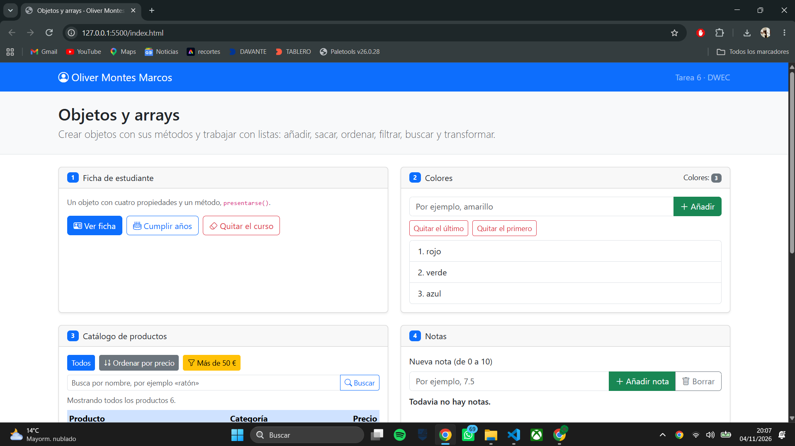
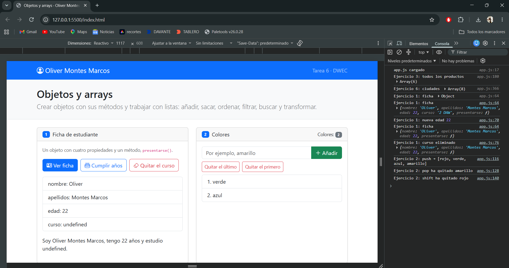
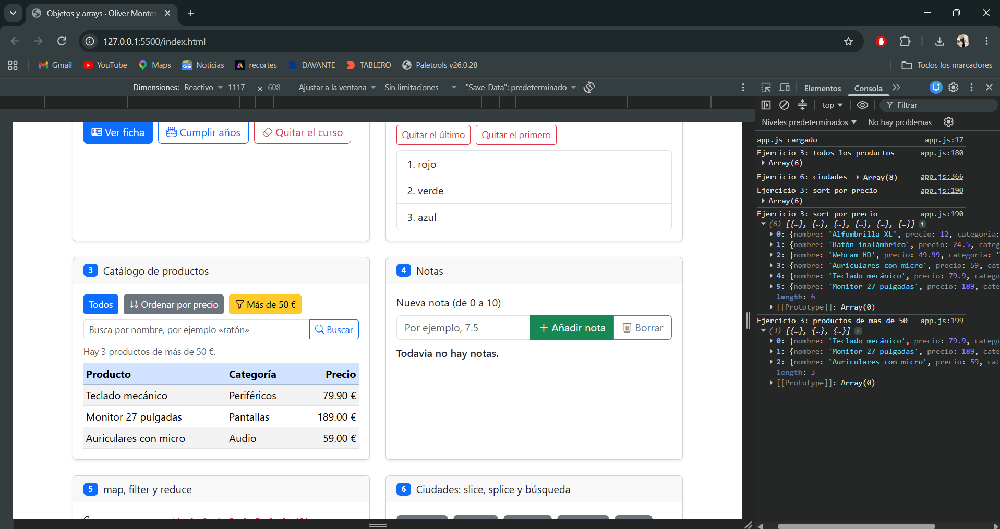
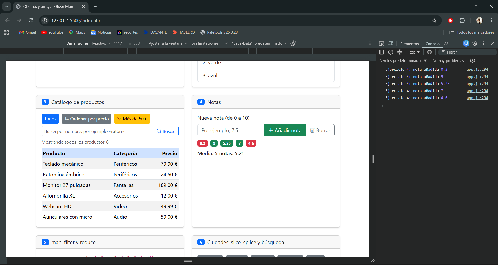
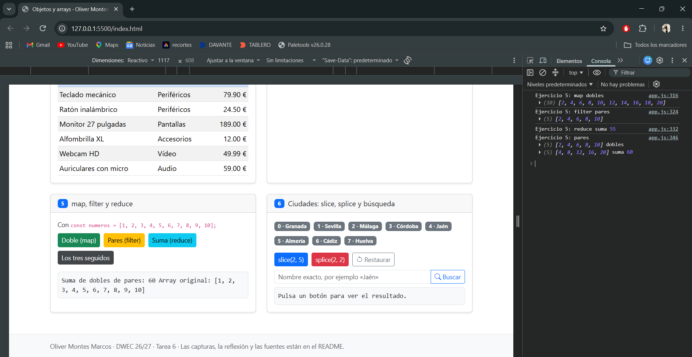
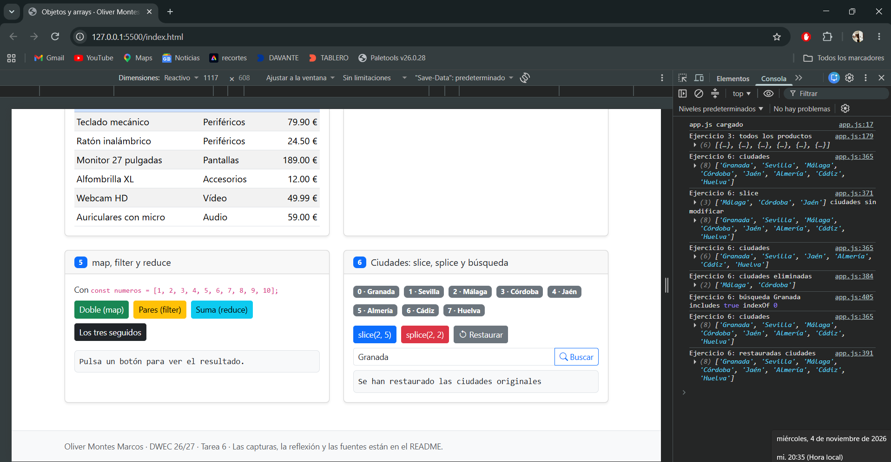

# Tarea 6 · Objetos y arrays

**Autor:** Oliver Montes Marcos · Desarrollo Web en Entorno Cliente (DWEC) · 2.º DAW · Curso 2026-27

En esta carpeta se encuentra la actividad del tema 6. Para probarla, abre `index.html` con Live Server desde Visual Studio Code. La página contiene seis ejercicios sobre objetos y arrays. Los resultados aparecen en cada tarjeta y se pueden consultar también los mensajes de la consola del navegador (F12).

## Capturas

Las seis imágenes de esta carpeta son evidencias que debo realizar en mi propio equipo. Sustituiré cada imagen de ejemplo por una captura real con el mismo nombre.

### a) La página recién cargada

Se muestra la página con mi nombre, los tres colores iniciales, el catálogo completo y las ocho ciudades.

### b) Ejercicios 1 y 2: la ficha y los colores

La ficha permite mostrar los datos, aumentar la edad y borrar el curso. En los colores se puede añadir y quitar el primer o el último elemento con `push`, `pop` y `shift`.

### c) Ejercicio 3: el catálogo ordenado por precio

La función `sort` utiliza una comparación que resta el precio de `a` al de `b`. Primero se crea una copia con `[...productos]` para ordenar esa copia y conservar intacto el catálogo original.

### d) Ejercicio 4: las notas y la media

Se muestran al menos cinco notas, con badges verdes para las notas iguales o superiores a 5 y rojos para las inferiores. La media se calcula con `reduce` y se presenta con dos decimales.

### e) Ejercicio 5: los tres métodos seguidos

Primero `filter` selecciona los números pares, después `map` duplica esos números y finalmente `reduce` suma los dobles. El resultado final es 60.

### f) Ejercicio 6: después de splice y de buscar una ciudad

`splice(2, 2)` elimina Málaga y Córdoba de la lista original. Después se realiza una búsqueda para comprobar el resultado de `includes` y `indexOf`.

## Reflexión

Los métodos `push`, `pop`, `shift`, `sort` y `splice` modifican el array sobre el que se ejecutan. En cambio, `slice`, `map` y `filter` devuelven un nuevo array y dejan intacto el original. En el ejercicio 6, `slice(2, 5)` selecciona algunas ciudades, pero no las elimina. `splice(2, 2)` sí modifica la lista y quita dos elementos desde la posición indicada. Por eso, en el ejercicio 3 ordeno una copia de `productos`: así puedo mostrar el catálogo ordenado sin alterar el array inicial.

## Fuentes

- [MDN: Arrays](https://developer.mozilla.org/es/docs/Web/JavaScript/Reference/Global_Objects/Array)
- [MDN: Objetos](https://developer.mozilla.org/es/docs/Web/JavaScript/Guide/Working_with_objects)

## Uso de IA

He utilizado ChatGPT como ayuda para entender bien el apartado del log.