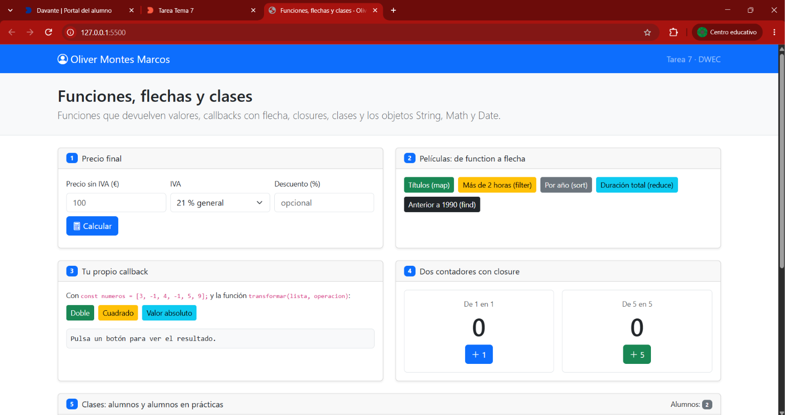
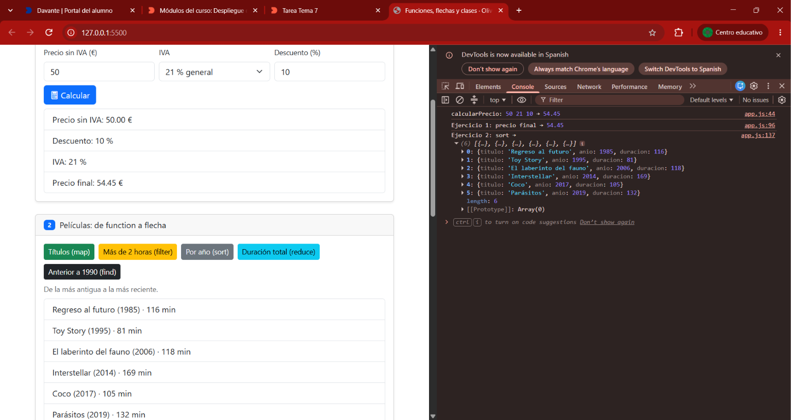
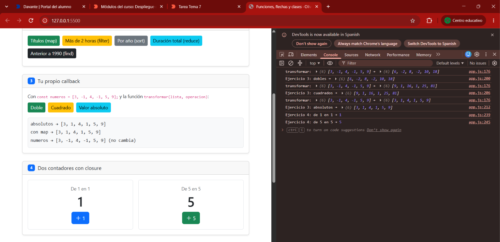
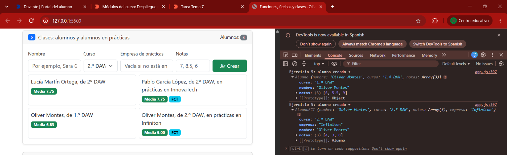
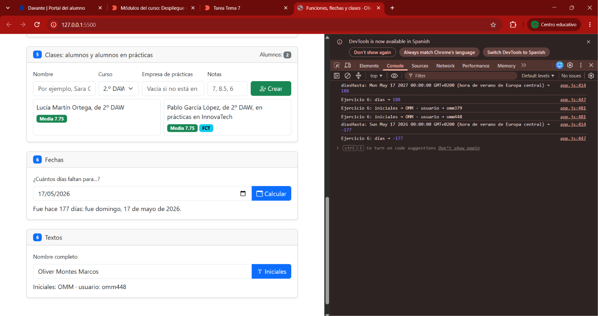

# Tarea 7 · Funciones, flechas y clases

**Autor:** Oliver Montes Marcos · Desarrollo Web en Entorno Cliente (DWEC) · 2.º DAW · Curso 2026-27

Página con seis ejercicios sobre funciones que devuelven valores, callbacks con flecha, closures, clases y los objetos String, Math y Date. Para verla, abre la carpeta en VS Code, pulsa **Go Live** y prueba los botones con la consola abierta (F12): cada función deja su rastro con `console.log()`.

## Capturas

### a) La página recién cargada

Nada más cargar se ve mi nombre en la navbar y los dos alumnos de partida del ejercicio 5: Lucía Martín Ortega (un `Alumno`) y Pablo García López (un `AlumnoFCT` en InnovaTech, con la etiqueta FCT).

### b) Ejercicios 1 y 2: el precio y las películas

Un precio de 50 € con un 10 % de descuento y el 21 % de IVA da 54,45 € (en la consola se ve la llamada a `calcularPrecio(50, 21, 10)`). `calcularPrecio()` solo calcula y devuelve el resultado con `return`; `mostrarPrecio()` lee el formulario, valida y pinta el desglose. Debajo, el botón «Por año», con `sort` sobre una copia del array.

### c) Ejercicios 3 y 4: tu callback y los contadores

`transformar()` recorre la lista con `for…of`, llama al callback con cada número y guarda lo que devuelve en un array nuevo, así que `numeros` no cambia y el resultado coincide con el de `map`. Los dos contadores no se mezclan porque cada llamada a `crearContador()` crea su propia variable `cuenta`, y la función que devuelve la sigue recordando aunque `crearContador()` ya haya terminado: eso es un closure. Si escribo `cuenta` en la consola sale `ReferenceError: cuenta is not defined`, porque esa variable solo existe dentro de la función y no se puede tocar desde fuera.

### d) Ejercicio 5: los alumnos

Cuatro alumnos, dos de ellos en prácticas. `crearAlumno()` mira la casilla de la empresa: si está vacía crea un `Alumno` con `new` y, si no, un `AlumnoFCT`, que hereda de `Alumno` con `extends` y llama a `super()` en el constructor y a `super.presentarse()` para añadir la empresa.

### e) Ejercicio 6: fechas y textos

He probado con el 17 de mayo de 2026, que ya pasó: salen -177 días, así que la página dice «Fue hace 177 días». Pongo hoy a medianoche con `setHours(0, 0, 0, 0)` y redondeo con `Math.round` porque, con el cambio de hora, algún día tiene 23 o 25 horas y la división no da un número entero. Con mi nombre salen las iniciales OMM y un usuario como omm448; las tres cifras cambian cada vez. Si el nombre tiene espacios dobles también funciona, gracias al `filter`.

## Reflexión

Al pasar un callback de `function` a flecha, el código hace lo mismo pero se lee mejor: desaparece la palabra `function` y, si el cuerpo es solo una expresión, también las llaves y el `return`, porque la flecha devuelve el valor sola. El `return` solo hace falta cuando pongo llaves; si las pongo y lo olvido, la función devuelve `undefined`. Por ejemplo, en mi código `peliculas.filter(function (pelicula) { return pelicula.duracion > 120; })` ha quedado como `peliculas.filter((pelicula) => pelicula.duracion > 120)`. Los métodos de una clase no se escriben con flecha porque la flecha no tiene su propio `this`, sino que lo coge del sitio donde se escribe; en `media()` necesito que `this` sea el alumno que llama al método para leer sus `this.notas`, y eso solo lo garantiza la forma corta `media() { … }`.

## Fuentes

- [Funciones flecha · MDN](https://developer.mozilla.org/es/docs/Web/JavaScript/Reference/Functions/Arrow_functions)
- [Parámetros predeterminados · MDN](https://developer.mozilla.org/es/docs/Web/JavaScript/Reference/Functions/Default_parameters)
- [Closures · MDN](https://developer.mozilla.org/es/docs/Web/JavaScript/Closures)
- [Clases · MDN](https://developer.mozilla.org/es/docs/Web/JavaScript/Reference/Classes)
- [Date.prototype.toLocaleDateString() · MDN](https://developer.mozilla.org/es/docs/Web/JavaScript/Reference/Global_Objects/Date/toLocaleDateString)
- [String.prototype.padStart() · MDN](https://developer.mozilla.org/es/docs/Web/JavaScript/Reference/Global_Objects/String/padStart)

## Uso de IA

He usado Claude como apoyo para resolver los ejercicios paso a paso: me propuso el código de cada función con una explicación de cómo funciona y los resultados que tenía que dar cada botón.
